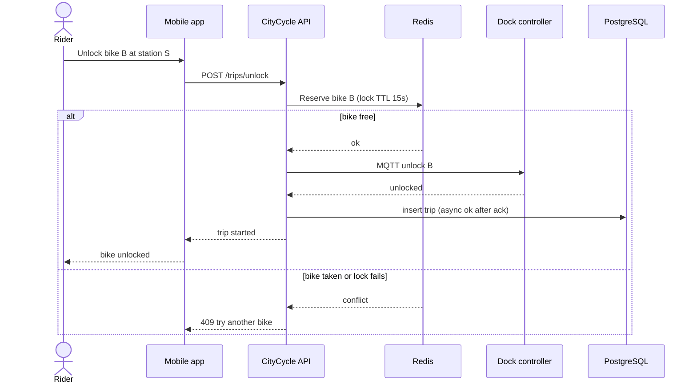

# Runtime View

## Unlock a bike

This is the system as it runs today. A hold that starts when the rider taps the bike, before this sequence, is under review in [RFC 0002](../rfc/0002-hold-a-bike-before-unlock.md). It is not part of this scenario until [ADR 0006](../adr/0006-short-hold-in-redis.md) is accepted.

Notable aspects: the rider waits for the dock ack, not for the PostgreSQL insert to finish. Redis holds a short lock so two riders cannot take the same bike. PostgreSQL remains the ledger once the trip exists.

## Return and charge

Omitted as a diagram. On dock-in, the dock emits an event; the API closes the trip in PostgreSQL, updates Redis counts, and captures payment. Failures in capture leave the trip in `pending_payment` for a retry job.
