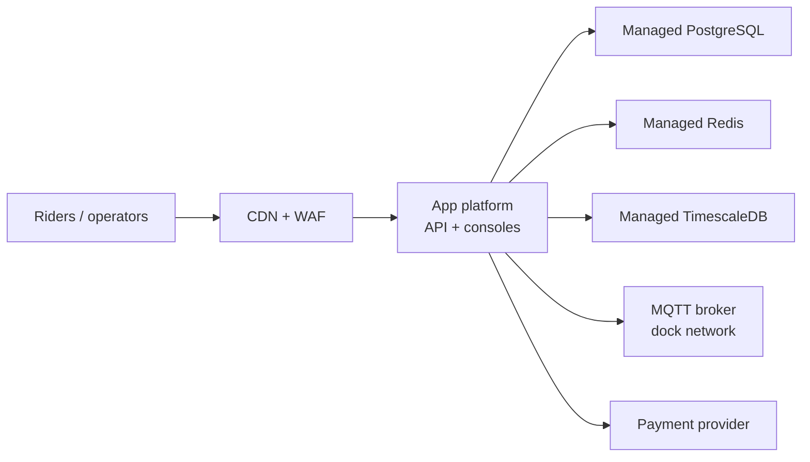

# Deployment View

## Infrastructure Level 1

Motivation  
One region, managed data stores, API on a container platform with two replicas. Enough for Riverside’s size; not a multi-region design.

Quality and/or Performance Features  
- API autoscales on CPU and unlock latency.  
- Redis and PostgreSQL are multi-AZ in the same region.  
- Dock MQTT is a vendor-managed broker; we treat it as an external dependency with an SLO of its own.

Mapping of Building Blocks to Infrastructure

| Building block | Where it runs |
|----------------|---------------|
| Mobile app | iOS / Android stores |
| Operator console | Static assets on CDN, talks to API |
| CityCycle API | Container platform, 2+ replicas. Image is Node.js 22, one Fastify process, port 8080. `GET /health` checks the process, the pool, and Redis. |
| PostgreSQL | Managed service, private subnet, TLS. The API role cannot migrate. A CI job runs migrations as `citycycle_migrator`, then the rollout continues. |
| Redis | Managed service |
| TimescaleDB | Managed service, private subnet, TLS. Same region as PostgreSQL, different instance. Added with [ADR 0003](../adr/0003-battery-telemetry-separate-from-trip-store.md). |
