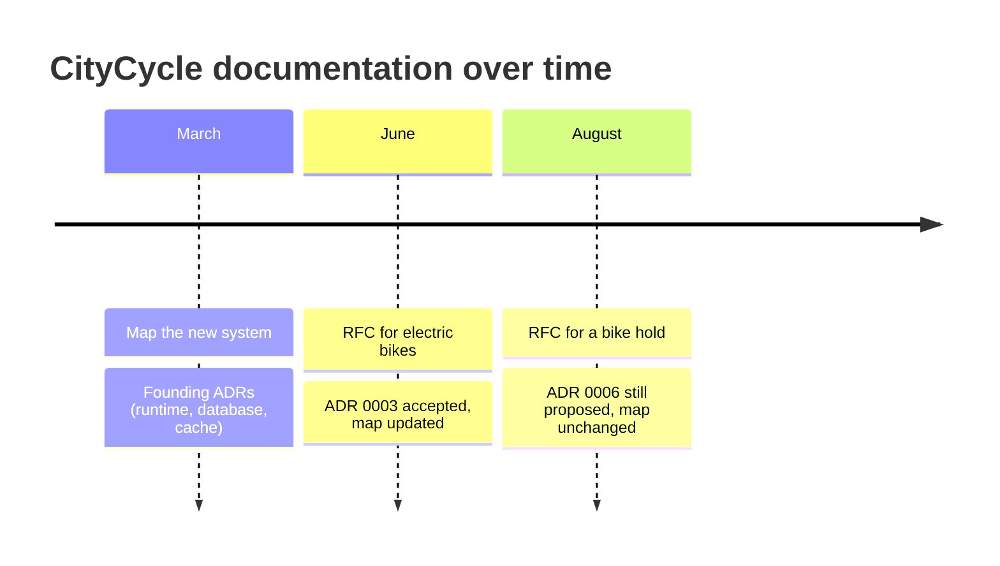

CityCycle is a fictional bike-sharing service. The product is an excuse. The documents are the point.

This page is the tour. It does not add a fourth format. It shows the same files you already have, in the order they were written, and names the advantage of each one. After this, read the files themselves.

## What the three documents do here

| Question on CityCycle | Document | What it is in this repo |
|-----------------------|----------|-------------------------|
| How should we add e-bikes? | RFC | [RFC 0001](rfc/0001-add-electric-bikes.md), then [RFC 0002](rfc/0002-hold-a-bike-before-unlock.md) still in review |
| Why is the trip ledger PostgreSQL? | ADR | [ADR 0001](adr/0001-postgresql-for-trips-and-inventory.md) |
| How does the system look today? | arc42 | [Sections 1–5](architecture/01_introduction_and_goals.md) and the [container diagram](architecture/diagrams/c4-containers.md) |

The rule is the same as in the [playbook](https://openmove.github.io/engineering-design-playbook/): an RFC is a proposal, an ADR is a closed decision, arc42 is the current map. Mixing them is how documentation rots.

## What you would lose without them

Imagine the same product with only tickets and chat.

- Six months later, nobody can say why trips are not in Mongo. The person who chose PostgreSQL has left. [ADR 0001](adr/0001-postgresql-for-trips-and-inventory.md) still lists the options and why they lost.
- The architecture page is a fifty-page document last touched at kickoff. Nobody updates it, so nobody trusts it. Here, the e-bike work updates only [section 5](architecture/05_building_block_view.md) and the [container diagram](architecture/diagrams/c4-containers.md).
- The e-bike debate happens again when a new engineer joins. [RFC 0001](rfc/0001-add-electric-bikes.md) already has the alternatives, including "put every battery sample in PostgreSQL".

That is the whole method: memory, a map that can stay current, and a debate you do not have twice.

## The story, in three moments

### 1. March — the system does not exist yet

Nobody writes an RFC of the whole product. The first day is a short map plus the choices that map rests on.

Read, in this order:

1. [Goals](architecture/01_introduction_and_goals.md) — unlock under 3 seconds, map counts at most 30 seconds stale. Those numbers, not "it should be fast", later force Redis.
2. [Context](architecture/03_context_and_scope.md) and the [context diagram](architecture/diagrams/c4-context.md) — riders, operators, docks, payments. Everything else is outside the box.
3. [Strategy](architecture/04_solution_strategy.md) — half a page. Each quality goal points at an ADR.
4. [Building blocks](architecture/05_building_block_view.md) and the [container diagram](architecture/diagrams/c4-containers.md) — one Fastify process, PostgreSQL, Redis.
5. The founding ADRs, by date, not by number:
   - [0004](adr/0004-nodejs-fastify-for-the-api.md) — Node.js and Fastify
   - [0001](adr/0001-postgresql-for-trips-and-inventory.md) — PostgreSQL is the ledger
   - [0005](adr/0005-postgresql-network-and-roles.md) — the ledger is private, two roles
   - [0002](adr/0002-redis-for-station-availability.md) — Redis for the hot path

**Advantage.** A new person can answer "why Redis?" from the quality goals and ADR 0002, without sitting in the original meeting. Sections 6, 8, 10 stay short until there is something real to write.

### 2. June — a later change, finished

The city adds 200 electric bikes. The solution is not obvious: battery samples every 10 seconds would drown the trip database.

The work goes through the chain:

1. [RFC 0001](rfc/0001-add-electric-bikes.md) — `Implemented`. Alternatives, rollout, a flag.
2. [ADR 0003](adr/0003-battery-telemetry-separate-from-trip-store.md) — `accepted`. Samples go to a time-series store. The latest percent stays on the bike row for unlock.
3. The [container diagram](architecture/diagrams/c4-containers.md) gains the telemetry store. [Section 5](architecture/05_building_block_view.md) names a `telemetry` module. The RFC is not the map.

**Advantage.** The debate is over, and it is still readable. The map matches production. Nobody has to reconstruct June from Slack.

### 3. August — a later change, still open

Support keeps hearing: the map showed a bike, the rider walked three minutes, someone else took it.

That work is **not** in the map yet:

1. [RFC 0002](rfc/0002-hold-a-bike-before-unlock.md) — `In review`. Hold the bike for 90 seconds in Redis. No trip until the dock acks.
2. [ADR 0006](adr/0006-short-hold-in-redis.md) — `proposed`. Not accepted.
3. [Runtime view](architecture/06_runtime_view.md) still describes today's unlock. It points at the RFC. `POST /holds` is not in section 5.

**Advantage.** You can tell a proposal from the system as it is. If this RFC is rejected, the map does not have a ghost feature. If it is accepted, the same loop as June closes: accept the ADR, then update section 5 and section 6.

## How to tell the documents apart

Open any file and ask one question.

| If you see… | You are in… |
|-------------|-------------|
| Alternatives, a rollout, status `Draft` or `In review` | An RFC. It can still change. |
| "Chosen option", status `accepted`, a date | An ADR. Do not rewrite it. |
| Status `proposed` on an ADR | A decision that has not happened. The map must ignore it. |
| A diagram of people and systems, or a list of deployable pieces | arc42. This is today. |
| Status `superseded by ADR-NNNN` | An old decision. The new ADR is the current one. |

## After the tour

Start a project from the empty [template](https://github.com/openmove/engineering-design-playbook), not from this repository. CityCycle is the filled notebook. Copying it would give you someone else's bike-sharing system.

If you only read three files after this page, read [section 1](architecture/01_introduction_and_goals.md), [ADR 0002](adr/0002-redis-for-station-availability.md), and [RFC 0001](rfc/0001-add-electric-bikes.md). That is the method: a measurable goal, a decision with losers, a later change that leaves a new decision and an updated map.
